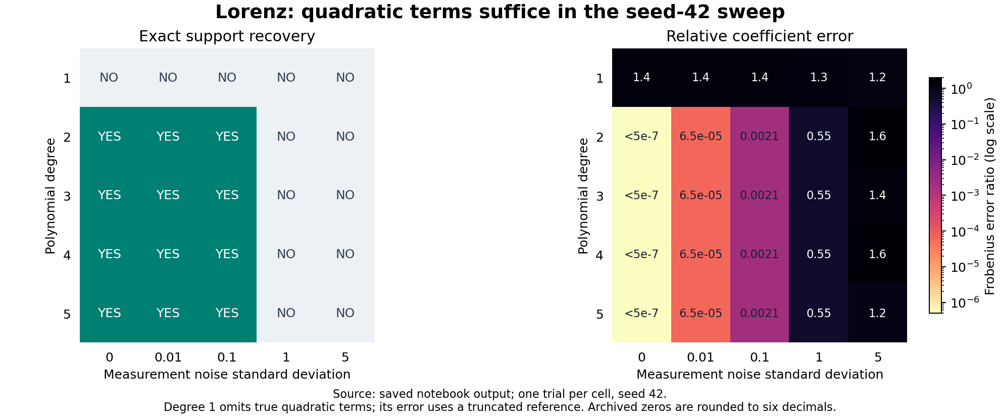

# SINDy: how much library complexity is enough?

From-scratch sparse equation discovery: a quadratic library matches larger libraries on the saved Lorenz noise sweep with less computation.

## Key result

In the archived sweep, the **degree-2 library recovers exact support at noise standard deviations 0, 0.01, and 0.1**, matching degrees 3–5 in the seed-42 sweep. Its relative coefficient error at 0.1 is **0.002088**.
In a fresh clean-data benchmark with **3 warmups and 25 measured runs per degree**, degree 2 takes a median **0.04138 s versus 0.08514 s** for degree 3: **48.6% of degree-3 runtime (2.06× faster)**, with both recovering exact support in every measured run. See the [raw timings](results/benchmark/timings.csv) and [environment metadata](results/benchmark/metadata.json).
There are three example systems, but only Lorenz has a saved PySINDy comparison. The implemented sweep is **degrees 1–5**, not 1–6.



*Figure regenerated from [saved notebook output](LorenzExampleSINDy%20%282%29.ipynb), exported to [CSV](results/archived/lorenz_sweep.csv). One trial per cell; no uncertainty estimates.*

## Problem / question

How much model complexity does equation discovery need, and how does it degrade under noise? SINDy fits derivatives to candidate functions: $dX/dt = \Theta(X)\Xi$. Sparse $\Xi$ selects terms for explicit differential equations.

## Approach and why

The Lorenz implementation performs sequential thresholded least squares (STLS):

1. Build monomials through degree $d$, including a constant and interactions.
2. Fit each equation with `numpy.linalg.lstsq`.
3. Zero coefficients with **absolute value < 0.1**; refit surviving columns.
4. Stop at a stable threshold mask, empty support, or 100 iterations.

No ridge penalty or normalization. Known Lorenz equations make recovery measurable; degree tests complexity, noise tests sensitivity.

**Support recovery:** exact equality of true/recovered masks at $|\Xi_{ij}| > 10^{-6}$. **Relative coefficient error:** $\|\Xi-\Xi_{true}\|_F / \|\Xi_{true}\|_F$, measuring accuracy beyond term selection.

<details>
<summary>Implementation details</summary>

- The oscillator uses `< threshold`, at most 10 iterations, and a support-stability stop. Lotka–Volterra uses `<= threshold` and 10 iterations without early stopping. Neither normalizes columns or adds regularization.
- The degree-1 Lorenz reference omits the unavailable quadratic coefficients. Its reported error is against that truncated matrix, not the complete Lorenz system.

</details>

## Validation

These are **saved observations**, not a three-system numerical agreement test:

| System | Check present | Saved result |
|---|---|---|
| Lorenz | Custom STLS vs printed PySINDy equations | Same active terms; custom coefficient of $x$ in $\dot y$ is 28.0000, PySINDy prints 27.998 |
| Lotka–Volterra | Custom STLS vs known equations | Clean coefficients 1, −1.5, −0.1, 0.05, to four printed decimals; no PySINDy check |
| Damped oscillator | Custom STLS vs known equations | Clean polynomial library: exact support, relative error 0.000036 in [result.txt](result.txt); no PySINDy check |

<details>
<summary>Validation gap</summary>

The Lorenz notebook compares printed equations only; custom STLS uses analytic derivatives while PySINDy estimates derivatives internally and leaves optimizer defaults in place.

</details>

## Experiments and results

The sweep pairs seed-42 Gaussian measurement noise across degrees; see the figure above.

Lorenz is quadratic: higher degrees add unnecessary candidates. In archived results, degrees 2–5 tie on support; all fail at noise 1 and 5. Degree 5 separately fails in **3/5 seeds** at noise 0.01; degree 2 lacks a paired test. **The fresh rerun changes some outcomes** (details below).

<details>
<summary>Setup, timing, and reproduction differences</summary>

Lorenz uses $(\sigma,\rho,\beta)=(10,28,8/3)$, initial state $(−8,7,27)$, and 50,000 samples over $[0,50)$ at $\Delta t=0.001$. The grid is degrees **1–5** × noise standard deviations **{0, 0.01, 0.1, 1, 5}**. Each cell resets seed 42, pairing the same Gaussian noise pattern across conditions. Noise is independent, additive, and in absolute state units.

`solve_ivp` uses RK45 with `rtol=atol=1e-10`. Clean Lorenz fits use analytic derivatives. Noisy fits differentiate noisy measurements with centered differences internally and one-sided differences at the endpoints; there is no smoothing. Thus the clean/noisy comparison also changes the derivative source.

The notebook times **one clean-data run per degree** with `time.time()`, including library construction and STLS but excluding trajectory generation and metric computation:

| Degree | Candidate terms | Seconds | Exact support |
|---|---:|---:|---|
| 1 | 4 | 0.0070 | No |
| 2 | 10 | 0.0170 | Yes |
| 3 | 20 | 0.0500 | Yes |
| 4 | 35 | 0.1890 | Yes |
| 5 | 56 | 0.3970 | Yes |

The archived ratio 0.0500/0.0170 ≈ 2.94 does not support the resume's 3.4× claim. That original timing has no warmups, repetitions, or saved hardware details.

The repeated benchmark uses the notebook's unchanged clean trajectory, analytic derivatives, library builder, and STLS solver. Each degree receives 3 untimed warmups followed by 25 measured runs. Degrees are interleaved in a seed-42 shuffled order each round. `time.perf_counter()` measures library construction plus STLS; trajectory generation, metrics, and support checks are excluded. Every measured degree-2–5 fit recovers exact support.

| Degree | Candidate terms | Median seconds | Interquartile range (s) | Exact support in all 25 runs |
|---|---:|---:|---:|---|
| 1 | 4 | 0.017605 | 0.016142–0.019706 | No |
| 2 | 10 | 0.041380 | 0.038478–0.044459 | Yes |
| 3 | 20 | 0.085144 | 0.078124–0.103443 | Yes |
| 4 | 35 | 0.226380 | 0.177059–0.263552 | Yes |
| 5 | 56 | 0.801621 | 0.631737–1.003778 | Yes |

The ratio of degree-2 to degree-3 medians is **0.4860**, or **48.6%**; its reciprocal is **2.06×**. These are measurements on this macOS ARM64 environment, not a universal speedup. [Raw timings](results/benchmark/timings.csv), [summary](results/benchmark/summary.csv), and [metadata including numerical library thread settings](results/benchmark/metadata.json) are saved separately from the archived results. The interquartile ranges describe run-to-run timing spread, not confidence intervals.

At noise 1, the degree-2 threshold diagnostic tries 0.05, 0.1, 0.2, 0.5, 1, and 2; none recovers exact support. The main grid keeps threshold 0.1 fixed.

A [fresh verification run](results/verification/lorenz.txt) with the [recorded environment](results/verification/metadata.json) completed in 77.38 s. It preserves clean quadratic recovery and the printed Lorenz/PySINDy comparison, but does not reproduce every archived result:

| Check | Archived | Fresh verification |
|---|---:|---:|
| Degree-2 error, noise 0.1 | 0.002088 | 0.002329 |
| Degree-5 support, noise 0.01, seed 42 | Correct | Incorrect |
| Degree-5 failures across five seeds | 3 | 2 |
| Degree-2 / degree-3 clean runtime (s) | 0.0170 / 0.0500 | 0.0388 / 0.0797 |

The original environment is unknown, so the cause cannot be isolated. Chaotic trajectory integration and high-degree least squares can be sensitive to numerical differences. The hero figure deliberately reports archived evidence, not fresh results. The new numerical PySINDy diagnostic finds identical support and a maximum absolute coefficient difference of 0.00201674; it is not a historical pass/fail test. In the pinned version, PySINDy defaults to ridge `alpha=0.05`, `max_iter=20`, and no column normalization, unlike the custom solver.

The Lotka–Volterra notebook adds noise directly to analytic derivatives, a different noise model. The oscillator compares polynomial, trigonometric, and exponential candidates; its CSV inputs are absent. The Lorenz case labeled “Deg 5, noise=0.01 — fail” actually recovers correct support for seed 42: the label is misleading.

</details>

## Limitations and next steps

One trajectory and one seed per cell limit generalization. Finite differences amplify noise; high-degree columns can be poorly conditioned. No held-out trajectories or weak/ensemble SINDy comparisons. Timings are repeated on one machine. Next: paired multi-seed sweeps and controlled derivative-estimator comparisons.

## Reproduce it

Tested with **Python 3.9.6** and [pinned dependencies](requirements.txt). These pins are a reproduction environment, not a recovered record of the original run.

```bash
python3 -m venv .venv
source .venv/bin/activate
python -m pip install -r requirements.txt
python scripts/reproduce.py plot  # regenerate the README figure from saved output
python scripts/reproduce.py run   # execute the original Lorenz experiment
python scripts/reproduce.py benchmark --warmups 3 --repeats 25  # repeated clean timings
```

Fresh logs, CSV, figure, environment metadata, and a numerical PySINDy diagnostic go to `results/reproduced/`. Repeated benchmark timings, summary, and environment metadata go to `results/benchmark/`; the benchmark enforces at least 1 warmup and 20 measured runs per degree. The [verified full run](results/verification/metadata.json) took **77 s** on macOS ARM64; allow longer on other machines.

<details>
<summary>Other notebooks and missing inputs</summary>

The helper runs the original Lorenz code, skipping its unpinned `%pip install pysindy` cell. It checks clean custom support and reports the PySINDy coefficient difference without inventing a historical acceptance tolerance. Lotka–Volterra can be run interactively with the same numerical dependencies; a notebook UI is not included in requirements.

The oscillator cannot currently be rerun; it also overwrites `result.txt` when executed.

</details>

## Repo layout

<details>
<summary>Files and their roles</summary>

```text
LorenzExampleSINDy (2).ipynb   # Lorenz STLS, PySINDy check, sweep, timing
LotkaExample.ipynb            # Predator–prey recovery and derivative-noise tests
DampedOscillatorExample.ipynb # Library comparisons; requires missing CSVs
result.txt                   # Saved oscillator equations and metrics
scripts/reproduce.py         # Archived plot export and fresh Lorenz execution
results/archived/            # Sweep exported from saved notebook output
results/verification/        # Fresh log, metrics, and environment for this README
results/benchmark/           # Raw repeated timings, medians, and environment
assets/lorenz_sweep.png       # Main figure
requirements.txt             # Tested numerical and plotting dependencies
```

</details>

## References

- Brunton, Proctor & Kutz (2016). [Discovering governing equations from data by sparse identification of nonlinear dynamical systems](https://doi.org/10.1073/pnas.1517384113). *PNAS*.
- de Silva et al. (2020). [PySINDy: A Python package for the sparse identification of nonlinear dynamical systems from data](https://doi.org/10.21105/joss.02104). *JOSS*.
